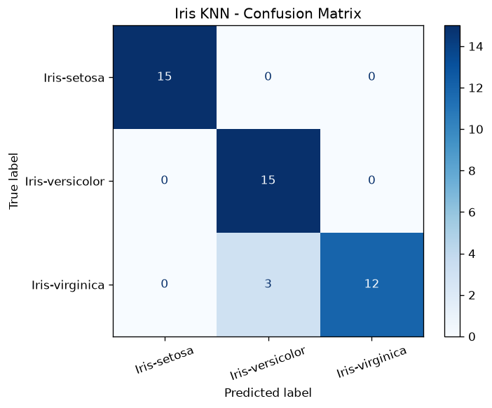

# Iris Flower Classification

A machine learning project that classifies Iris flowers into three species (*Iris-setosa*, *Iris-versicolor*, *Iris-virginica*) from their measurements, using Python and scikit-learn.

## Dataset

`Iris.csv` contains 150 samples, 50 per species, with these columns:

| Column | Description |
|---|---|
| `Id` | Row number (dropped before training) |
| `SepalLengthCm` | Sepal length in cm |
| `SepalWidthCm` | Sepal width in cm |
| `PetalLengthCm` | Petal length in cm |
| `PetalWidthCm` | Petal width in cm |
| `Species` | Target label (3 classes) |

## Project Structure

```
iris_project/
├── .gitignore
├── Iris.csv
├── iris_from_csv.py
├── confusion_matrix.png   (created when the script runs)
├── requirements.txt
└── README.md
```

## Setup

1. Install Python 3.9 or newer.
2. (Optional) Create and activate a virtual environment:
   ```
   python -m venv .venv
   .\.venv\Scripts\Activate.ps1
   ```
3. Install the dependencies:
   ```
   pip install -r requirements.txt
   ```

## Usage

Run the script from the project folder, with `Iris.csv` in the same folder:

```
python iris_from_csv.py
```

## Method

1. **Load data** with pandas and check for missing values and class balance.
2. **Select features and label.** The four measurements are the features (X) and `Species` is the label (y).
3. **Split** the data into training and test sets (stratified, `random_state=42`).
4. **Train and compare** three models: K-Nearest Neighbors (k=5), Logistic Regression and Decision Tree. KNN and Logistic Regression use feature scaling (`StandardScaler`).
5. **Evaluate** with accuracy, cross-validation, a classification report and a confusion matrix.
6. **Predict** the species of a new flower from its measurements.

## Results

KNN on a 30% test split (45 samples):

| True species | Correct | Notes |
|---|---|---|
| Iris-setosa | 15 / 15 | Perfectly classified |
| Iris-versicolor | 15 / 15 | Perfectly classified |
| Iris-virginica | 12 / 15 | 3 predicted as versicolor |

- **Accuracy:** 93.3% (42 / 45)
- **Versicolor precision:** 0.83
- **Virginica recall:** 0.80
- Using a 20% test split gave the same 93.3% accuracy with the same error pattern.



## Conclusion

Setosa is clearly separable from the other two species and is classified perfectly. Versicolor and virginica have overlapping petal and sepal measurements, so virginica samples are occasionally misclassified as versicolor. The error pattern is consistent across different splits, which shows the limitation comes from the data and not from the code.

## Key Concepts Covered

- Features and labels
- Train/test split and stratification
- Feature scaling
- Cross-validation
- Precision, recall, F1-score and confusion matrices

## Possible Improvements

- Tune `n_neighbors` or use `GridSearchCV` for hyperparameter search
- Try other models such as SVM or Random Forest
- Visualize the data with a seaborn pairplot

## 👤 Author

**Minahil Ashraf**
- GitHub: [minahil607](https://github.com/minahil-607)
- LinkedIn: [Minahil Ashraf](https://www.linkedin.com/in/minahil-ashraf-695812391)
- Email: minahilashraf669@gmail.com

---

⭐ If you found this project useful, consider giving it a star!